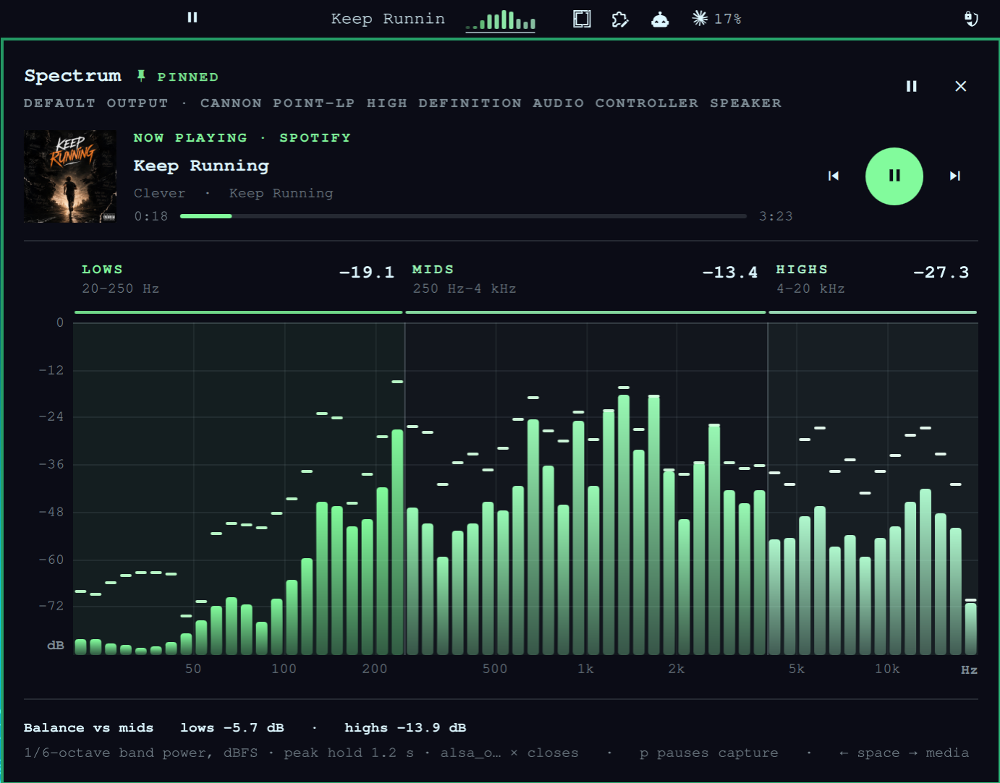
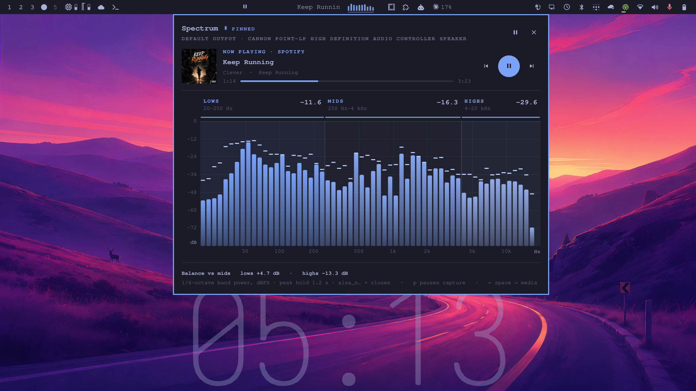

# Spectrum Remix

A remix of [Spectrum](https://github.com/dragosol/omarchy-spectrum) by Dragos Robu (MIT).





## Install

```bash
omarchy plugin add https://github.com/x22j/omarchy-spectrum-remix.git --enable
```

Shell plugins run unsandboxed with your user permissions, so review the
repository before enabling it. Add **Spectrum Remix** to the bar from the bar's
widget settings if it is not placed for you (it defaults to the center section).

- **Theme-matched bars**: every band is shaded from the current theme's accent
  colour (lows = accent, mids/highs blend toward the foreground), so it follows
  `omarchy theme set` live. Set `"colorMode": "palette"` in the widget's
  `shell.json` entry for the original warm/mid/cool palette picks.
- **Now Playing** in the hover card: album art, title, artist · album,
  progress, and previous / play-pause / next buttons. The buttons work straight
  from the hover preview. When the card is pinned, ← / space / → (or `[` `]`)
  do the same. It uses Omarchy's own media service, so it controls the same
  player as your media keys.

Everything else (click to pin, middle-click pauses the capture, IPC, etc.) works
as in the original, under the id `jstn.spectrum-remix`:

```bash
omarchy-shell jstn.spectrum-remix open | close | toggle | pause | resume | state
```

Pause state: `~/.config/omarchy/spectrum-remix.json`.
Control FIFO: `$XDG_RUNTIME_DIR/omarchy-spectrum-remix.ctl`.
